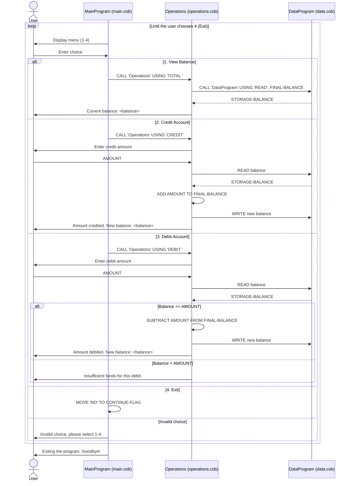

# Student Account Management System (COBOL)

This legacy COBOL application manages a single student account balance for the school's accounting office. Staff can view the balance, credit the account (for example, record a payment or refund) and debit the account (for example, record a purchase or fee).

The program is split into three COBOL source files in `src/cobol/`:

| File | Program ID | Responsibility |
| --- | --- | --- |
| `main.cob` | `MainProgram` | User interface: shows the menu, reads the user's choice and dispatches to `Operations` |
| `operations.cob` | `Operations` | Business logic for viewing, crediting and debiting the student account |
| `data.cob` | `DataProgram` | Data layer: stores the balance and handles `READ` / `WRITE` requests |

## File details

### `main.cob` — MainProgram

The entry point of the application.

- Displays the **Account Management System** menu in a loop until the user exits:
  1. View Balance
  2. Credit Account
  3. Debit Account
  4. Exit
- Reads the choice into `USER-CHOICE` (`PIC 9`, a single digit).
- Calls `Operations` with an operation code:
  - `1` → `'TOTAL '`
  - `2` → `'CREDIT'`
  - `3` → `'DEBIT '`
  - `4` → sets `CONTINUE-FLAG` to `'NO'` and ends the loop.
- Any other choice prints `Invalid choice, please select 1-4.` and shows the menu again.
- On exit it prints `Exiting the program. Goodbye!`.

### `operations.cob` — Operations

Implements the account operations. It receives a 6-character operation code (`PASSED-OPERATION`).

Key functions:

- **`TOTAL ` (view balance)**: reads the balance from `DataProgram` and displays `Current balance: <balance>`.
- **`CREDIT` (credit account)**: prompts `Enter credit amount: `, reads the current balance, adds the amount, writes the new balance back and displays `Amount credited. New balance: <balance>`.
- **`DEBIT ` (debit account)**: prompts `Enter debit amount: `, reads the current balance and:
  - if the balance is **greater than or equal to** the amount, subtracts it, writes the new balance and displays `Amount debited. New balance: <balance>`;
  - otherwise displays `Insufficient funds for this debit.` and leaves the balance unchanged.

### `data.cob` — DataProgram

The persistence layer. It keeps the balance in `STORAGE-BALANCE` and is called with an operation and a balance parameter:

- **`READ`**: copies `STORAGE-BALANCE` into the caller's `BALANCE`.
- **`WRITE`**: copies the caller's `BALANCE` into `STORAGE-BALANCE`.

Because `STORAGE-BALANCE` lives in `WORKING-STORAGE`, the value persists between calls for as long as the program runs, but it is **not saved to disk**. Every new run starts again at 1,000.00.

## Business rules for student accounts

1. **Starting balance**: every account starts at **1,000.00**.
2. **Single account**: the system manages one student account per run. There is no student ID or account lookup.
3. **Amount format**: balances and amounts use `PIC 9(6)V99`, which means:
   - unsigned values only (no negative balances or amounts);
   - a maximum of **999,999.99**;
   - exactly two decimal places.
4. **Credits** always succeed and increase the balance by the entered amount.
5. **Debits** are only allowed when the balance is **at least** the debit amount. Overdrafts are rejected with `Insufficient funds for this debit.`, and the balance stays the same.
6. **Data integrity**: the balance is always read from `DataProgram` before an operation and written back only after a successful credit or debit.
7. **Menu validation**: only choices `1`–`4` are accepted. Anything else shows an error and redisplays the menu.

## Data flow

